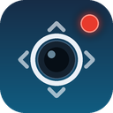
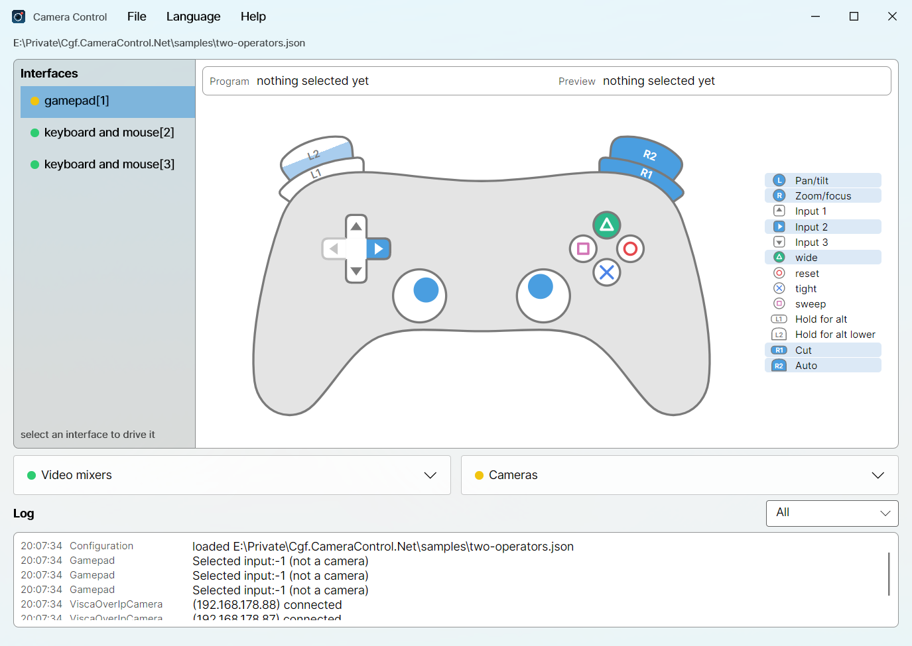
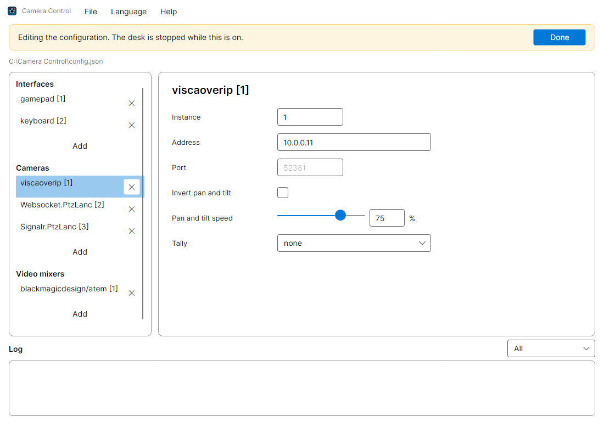

#  Camera Control

> [!WARNING]
> **Beta software.** Configuration and user-facing behavior may change incompatibly between releases.

Drive Blackmagic ATEM switchers and PTZ cameras from a game controller.



The screenshots use a passthrough mixer and simulated controllers and cameras.

This is a .NET port of [Cgf.CameraControl.Main](https://github.com/sensslen/Cgf.CameraControl.Main),
the headless TypeScript implementation.

## What it does

- Steers the preview camera and stops it when preview changes.
- Runs cut, auto, keyer toggles and macros, including conditional macro toggles.
- Combines camera tally from preview and program buses.
- Shows live controller bindings, connection lamps and a component-filtered log.
- Provides configurable keyboard and mouse controls.
- Rumbles on transitions, cameras going on air and lost connections.

## Install

| Platform | |
| --- | --- |
| Windows | `winget install Sensslen.CameraControl`, or the installer from [Releases](../../releases) |
| macOS | the `.dmg` from [Releases](../../releases), then drag to Applications |
| Linux | `flatpak install ./CameraControl-<version>-linux-x64.flatpak` |

Every binary is NativeAOT compiled, so there is no .NET runtime to install.

Release notes identify unsigned Windows or ad-hoc-signed, unnotarized macOS builds. Windows may
show SmartScreen. On macOS, use **System Settings → Privacy & Security → Open Anyway**, or
`xattr -dr com.apple.quarantine "/Applications/Camera Control.app"`.

## Configure

Open `config.json` with **File → Import**. The application reopens that file on startup.
See the [configuration reference](docs/Configuration/README.md) for fields and validation.

| Sample | Purpose |
| --- | --- |
| [offline.json](samples/offline.json) | check the interface with a passthrough mixer, without a switcher |
| [two-operators.json](samples/two-operators.json) | a gamepad and two keyboards sharing one mixer |

### Editing the configuration

Open **File → Edit configuration**. The editor also opens on startup without a configuration.



Cameras and mixers disconnect during editing.

| Action | Behavior |
| --- | --- |
| Add | choose a type, then its fields; cancel creates no entry |
| Delete camera | show references and remove the camera from their maps |
| Delete mixer | show references; affected interfaces need another mixer |
| Edit | title and validation summary stay above the scrolling form; errors appear under inputs |
| Pan/tilt speed | linked slider and percentage box |
| Controller serial | suggestions also accept unlisted controllers |
| Done → Save | rewrite the file, preserve fields outside the form, discard JSON comments and load the saved file |
| Done → Discard | reload the file from disk |

Duplicate instances, missing required fields and undefined camera, mixer or function references
block saving. Selecting a mixer input without a mapped camera is valid.
Functions and bindings are preserved as JSON, not edited in the form.
The editor follows the selected language's reading direction.

### Cameras

Supports VISCA over UDP and websocket/SignalR LANC controllers.
See [camera configuration](docs/Configuration/Cameras.md) for connection fields, speed and tally.

See [camera compatibility](docs/CameraCompatibility.md) for tested cameras.

### Controller bindings


See [gamepad bindings](docs/Configuration/Interfaces.md#gamepad) for controls and live indicators.
SDL uses one normalized layout.
See [choosing a gamepad backend](docs/Configuration/Interfaces.md#choosing-a-gamepad-backend).

### The keyboard panel


See [keyboard controls](docs/Configuration/Interfaces.md#keyboard) for the panel, mouse behavior,
key names and focus requirements. Configure separate interfaces to share a mixer between operators.

### Languages

English plus ten more, picked from the operating system on first run and changeable under
**Language**. English is the source text; every translation is machine made and none has been
reviewed by a native speaker.

## Build

Requires the .NET 10 SDK.

```bash
dotnet build
dotnet format --verify-no-changes
```

The test projects are Microsoft.Testing.Platform executables, so run them directly rather than
through `dotnet test`:

```bash
for suite in tests/*/bin/Debug/net10.0/*.Tests; do "$suite"; done
```

### Application icons

SVG and raster artwork share one generator. Generation needs Pillow; verification uses only
Python's standard library:

```bash
python packaging/icon/generate.py
python packaging/icon/verify.py
python -m unittest discover -s packaging/icon -p "test_*.py"
```

Add `--windows-exe <path>` for each Windows executable or installer. Verification compares all
embedded sizes with the ICO, decodes PNG and classic ICNS RGB, and compares the caption glyph with
`packaging/icon/appicon-caption.png`. CI checks assets and assignments; Windows releases check
the NativeAOT binary and installer.

The title bar uses a high-DPI raster of the small glyph. Windows executables, shortcuts, uninstall
metadata and dialog windows use the ICO. macOS bundles use `AppIcon.icns`; the Linux window class
matches the desktop file and Flatpak icon identity.

### Layout

| Project | |
| --- | --- |
| `Cgf.CameraControl.Core` | the domain: factories, configuration, the mixer and camera contracts |
| `Cgf.CameraControl.Atem` | ATEM support over AtemSharp |
| `Cgf.CameraControl.Cameras.WebsocketPtzLanc` | the websocket PTZ LANC camera |
| `Cgf.CameraControl.Cameras.SignalrPtzLanc` | the SignalR PTZ LANC camera |
| `Cgf.CameraControl.Cameras.ViscaOverIp` | the VISCA over IP camera |
| `Cgf.CameraControl.Input.Sdl` | the controller logic and the SDL device layer |
| `Cgf.CameraControl.Licenses.Generator` | compiles the licence report into the app |
| `Cgf.CameraControl.App` | the Avalonia window and the composition root |

Only the app references Avalonia and only `Input.Sdl` references SDL, so everything else is testable
without a display or a controller.

### The `--aot-probe` switch

AtemSharp reflects over command types, and NativeAOT translations use embedded resources rather
than satellite assemblies. Trimming can break either without a build failure.
`CgfCameraControl --aot-probe` checks ATEM command decoding, SignalR state serialization through
the hub protocol and every language. It exits non-zero on failure. Releases run it on every binary
before upload.

### Third-party licences

**Help → Third-party licences** lists shipped packages and artwork. Rows show full licence text,
using the package's published text or its declared SPDX licence. `Cgf.CameraControl.Licenses.Generator`
embeds texts and reports, with no runtime fetching. Artwork uses a separate hand-written report.
Missing text or a missing package report fails the build.

Texts are committed; each build generates its package report from restored versions.
After changing a package reference, refresh it with:

```bash
dotnet tool restore
python packaging/licenses/fetch-texts.py
```

| Option | Effect |
| --- | --- |
| `--report-only` | generate the report without changing committed texts; used by workflows |
| `--runtime win-x64` | include packages with assets for that runtime; each release supplies its identifier |

Other platforms' native packages resolve empty placeholders and are excluded. Each binary embeds
only texts named by its report.
CI checks the whole dependency graph with nuget-license's allowed-licence list.
Reports exclude Debug-only diagnostics and build tools, including the host-specific NativeAOT
compiler and trimmer, so build-machine packages do not enter shipped credits.

## Licence

MIT. See [LICENSE](LICENSE).
