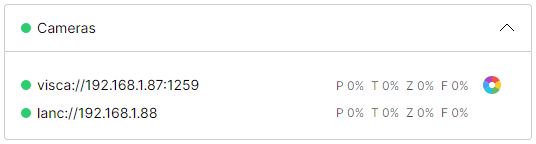
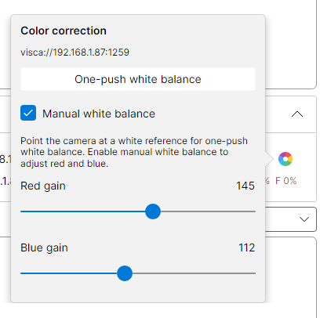
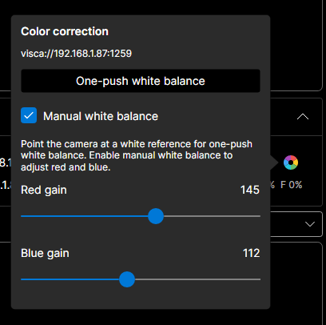

# VISCA color correction

Adjust a camera's white balance from the Cameras pane without changing the configuration.
The screenshots show the actual application with simulated camera data, not a hardware test.

## Supported cameras

Configure the camera as `viscaoverip` with its address and raw VISCA UDP port.
No additional configuration setting is needed. Color correction is independent of `tallyMode`.

The application checks support by reading white-balance mode, red gain and blue gain.
The color-wheel button appears only after all three inquiries return valid settings.
The LANC camera types do not offer these controls.

The CineTreak CT-PT31K lists automatic, manual and one-push white balance in its manual.
These new controls have not yet been verified on that camera. See
[camera compatibility](CameraCompatibility.md) for the commands and hardware verification status.

## Open the popover

Expand **Cameras**, then click the color wheel beside the camera you want to adjust.
Rows without color correction keep an empty wheel slot so camera movement status stays aligned.
The address in the popover identifies the camera receiving the commands. Its pointer aims at
that camera's button, including when the popover changes sides or shifts to fit the screen.

Click outside the popover or press **Escape** to close it. Closing does not undo adjustments.
Keyboard camera controls pause while it is open, and any held keyboard movement is released.
Game controllers remain active.

## One-push white balance

1. Point the camera at a white reference under the lighting you will use.
2. Click **One-push white balance**. The application selects one-push mode and sends its trigger.
3. Wait for the camera to complete the command and for the settings to reload.

One-push measures white balance once. It does not enable continuous automatic white balance.
To return to automatic white balance, turn **Manual white balance** on and then off.

## Manual corrections

Enable **Manual white balance**, then adjust **Red gain** and **Blue gain**.
Increasing red gain adds red; increasing blue gain adds blue. Each slider accepts whole values
from **0 to 255**. The number beside it shows the selected value.

Changes are sent immediately. There is no Apply or Save button.
Turning manual white balance off restores automatic white balance, which can change the balance
again as the lighting changes.

The panel reads settings when opened and after white-balance changes. Controls are disabled while
those readings are pending; gain sliders also require manual white balance.
These settings belong to the camera, not the configuration file. Whether they survive a camera
restart depends on the camera.

The popover follows the application's light or dark theme.

## If controls are missing or unavailable

If no color wheel appears, check the camera's connection, VISCA port and support for the three
inquiries. A connected camera can still lack color correction.

Select **ViscaOverIpCamera** in the log to see refused commands, unsupported inquiries and
timeouts. A timed-out white-balance action is not automatically replayed.
Close and reopen the popover to read settings again after a failed operation.
