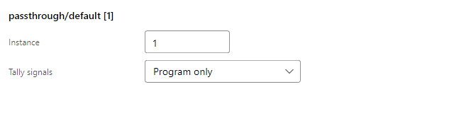

# Video mixers

Entries in `videoMixers`. An interface names one by `instance` in its `videoMixer`, and every input
number in that interface's `cameraMap` and `keys.input` is one of this mixer's inputs.

| `type` | Talks to | Needs |
| --- | --- | --- |
| `blackmagicdesign/atem` | an ATEM switcher over the network | `ip`, `mixEffectBlock` |
| `passthrough/default` | nothing | — |

## Tally signals

Both mixer types accept `tallyMode`. It controls the signals sent to every camera mapped by an
interface using that mixer, independently of the camera's tally protocol.

| `tallyMode` | This mixer's contribution |
| --- | --- |
| `preview-program` | preview and program, with program taking priority; the default |
| `program` | program only; off for preview cameras |
| `none` | off for all mapped cameras |

For example, `"tallyMode": "program"` on an ATEM mixer contributes a lit tally only for its
on-air camera. Disabling tally sends off updates rather than ignoring changes.
Program-only and disabled tally initialize this mixer's contribution to off when the interface
starts. Preview selection and camera steering are unchanged.

When interfaces using different mixers map the same camera instance, the camera combines their
contributions after applying each mixer's `tallyMode`. **Program wins over preview, and preview wins
over off**, regardless of which mixer updated last. A disabled mixer cannot turn off a camera that
another mixer has on program or preview.

For example, a camera on program in mixer 1 and preview in mixer 2 displays program. When mixer 1
selects another camera, it falls back to mixer 2's preview. It turns off only when no interface
contributes program or preview. Removing an interface withdraws only its own contribution, including
when several interfaces share the same mixer.

Set **Tally signals** in the mixer's editor. Keep the camera's `tallyMode` set to its supported
protocol, such as `avonic` or `ptzoptics` for VISCA. A camera configured with no tally protocol
cannot receive tally commands, regardless of the mixer's setting.



## `blackmagicdesign/atem`

```json
{ "type": "blackmagicdesign/atem", "instance": 1, "ip": "192.168.1.240", "mixEffectBlock": 0 }
```

| Key | Means |
| --- | --- |
| `ip` | the switcher's address |
| `mixEffectBlock` | which M/E to drive, counted from zero |

Preview, program, cut and auto all go to the switcher, and it is the switcher that says what is
live. The tally an interface sets on its cameras follows what the switcher reports rather than what
the operator last pressed.

## `passthrough/default`

```json
{ "type": "passthrough/default", "instance": 1 }
```

No switcher. It remembers what was selected and reports it back, so cameras, tally and the whole
interface work with nothing but cameras on the network. This is what to configure when the point is
to point cameras rather than to cut between them, and what the samples use so they run anywhere.
