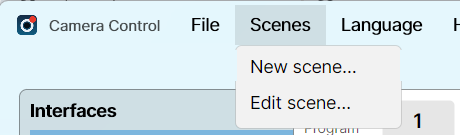
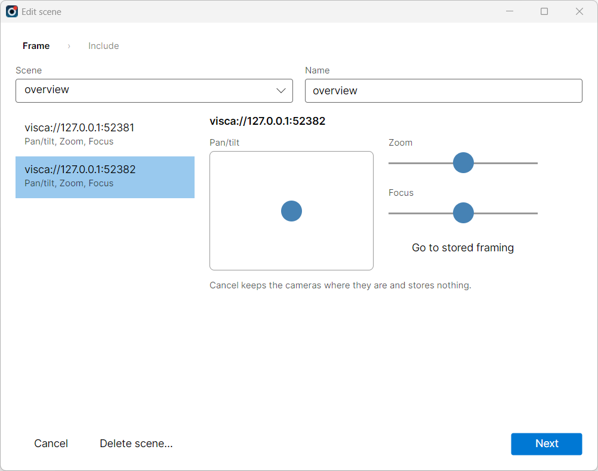
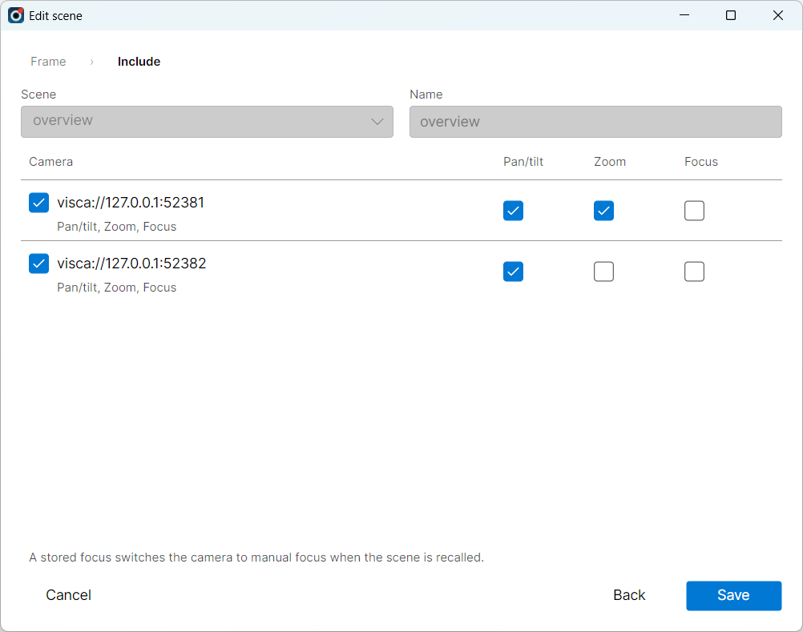
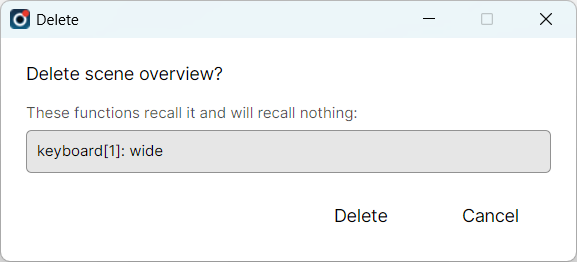

# Scenes

A scene stores a framing for several cameras under one name. Recalling it drives every stored
camera to its framing, except a camera that is on program.

## Supported cameras

Only `viscaoverip` cameras can store and recall framings. A scene stores up to three parts per
camera:

| Part | VISCA reads it with | and recalls it with |
| --- | --- | --- |
| Pan/tilt | `8x 09 06 12 FF` | `8x 01 06 02 …` absolute move at the camera's `panTiltSpeedPercent` |
| Zoom | `8x 09 04 47 FF` | `8x 01 04 47 …` direct zoom |
| Focus | `8x 09 04 48 FF` | `8x 01 04 38 03 FF` manual focus, then `8x 01 04 48 …` direct focus |

Cameras differ in which of these they answer. The wizard asks each camera when it opens and offers
the parts that camera answered, plus any part the edited or starting scene already stores for it.
A camera that answers none is listed with the reason and cannot be included.

## Creating and editing scenes



Open **Scenes → New scene…** or **Scenes → Edit scene…**. Edit scene is available once a scene
exists, and both need a loaded configuration file. The wizard opens as a dialog. The main window,
its keyboard interfaces, the File and Scenes menus and edit mode are unavailable until it closes.
Cameras and mixers stay connected, and gamepads keep working.

The wizard has two steps, **Frame** and **Include**.

### Frame



New scene asks for a name and, under **Start from**, an existing scene whose cameras, parts and
framings it copies. Edit scene picks the scene under **Scene** and allows a rename in **Name**.

The list on the left shows every camera and, under each, the parts it answered. Choose one and
frame it with the pan/tilt pad and the zoom and focus sliders. They work like the
[keyboard panel](Configuration/Interfaces.md#keyboard) and stop the camera when released or when
another camera is chosen. Without a mouse, Tab to a pad or slider and hold the arrow keys: a held
key drives at full speed, and the camera stops when it is released or focus moves on. **Go to stored framing** drives the camera to what the edited or starting
scene holds for it.

**Next** needs a name no other scene has.

### Include



Tick the cameras the scene stores and, for each, the parts. The parts the edited or starting scene
stores start ticked, and so does every part moved in the frame step. **Back** returns to framing
with the ticks kept. **Save** writes the scene:

| Part | Stored value |
| --- | --- |
| moved in the frame step, or with nothing stored yet | read from the camera at Save |
| otherwise | kept from the edited or starting scene |

A camera that does not report a part read at Save blocks Save and is named under the buttons.
A scene keeps the cameras it stores that are not configured or did not answer, and can be saved
with only those.

### Leaving without saving

**Cancel**, **Escape** and the dialog's close button leave without storing anything. Cameras stay
where they were framed.

### Saving, renaming and deleting

Save writes the configuration file and does not reload it. A rename also renames every `scene`
function that recalled the old name, and then reloads the file so the interfaces use the new name.



**Delete scene…** in the frame step of Edit scene asks first and lists the functions that recall
the scene. They stay in the file and recall nothing. Saving drops comments from the file, as the
[configuration editor](../README.md#editing-the-configuration) does.

## Recalling

Bind a [`scene` function](Configuration/Interfaces.md#functions) to a key or a face button:

```json
"functions": { "sermon": { "type": "scene", "name": "sermon" } },
"keys":      { "function": { "F5": "sermon" } }
```

The keyboard panel and the gamepad legend show the function's name like any other function. A
press looks the scene up by name, ignoring case and surrounding spaces, so a scene saved after the
file was loaded is recalled without a reload. A press naming no saved scene is logged.

Every stored camera moves except one that any interface has on program. Each camera moves its
parts one after another: pan/tilt, then zoom, then focus. Moving a stick or key for an axis
cancels that axis's part if it has not started yet. A recall does not resume after a camera
reconnects.

## In the file

```json
"scenes": [
  {
    "name": "sermon",
    "cameras": {
      "1": { "pan": -500, "tilt": 120, "zoom": 4096 },
      "2": { "focus": 512 }
    }
  }
]
```

| Key | Means |
| --- | --- |
| `name` | unique, ignoring case and surrounding spaces |
| `cameras` | camera `instance` to the parts stored for it |
| `pan`, `tilt` | stored together, in the camera's signed position units |
| `zoom`, `focus` | the camera's position units |

A scene with an unknown property, a camera storing nothing, `pan` without `tilt`, or a name another
scene already has is logged and can be neither recalled nor edited. Saving keeps it unchanged.
